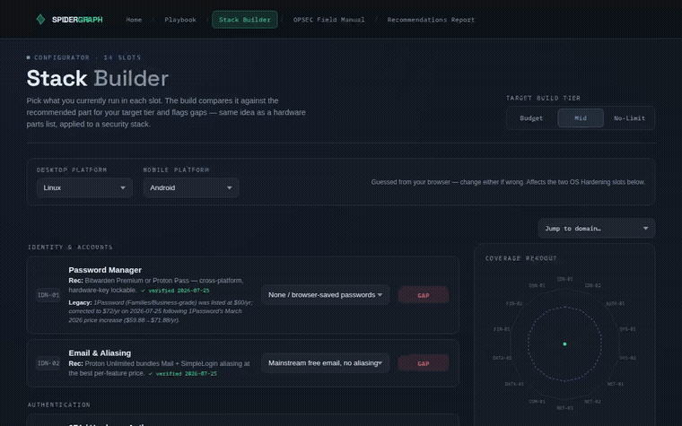

# Spidergraph

[](https://github.com/nixbys/spidergraph/actions/workflows/ci.yml)
[](https://github.com/nixbys/spidergraph/actions/workflows/deploy.yml)
[](LICENSE)

**Live site: https://nixbys.github.io/spidergraph/**

A personal privacy and security program that runs entirely in the browser: a tiered
playbook, six self-audit tools and a recommendations report. There is no backend, no
account and no tracking. The name comes from the radar chart that plots your coverage
across every security domain as one shape.



## Pages

| Page                                                                                       | What it does                                                                                                                                                |
| ------------------------------------------------------------------------------------------ | ----------------------------------------------------------------------------------------------------------------------------------------------------------- |
| [Playbook](https://nixbys.github.io/spidergraph/playbook/)                                 | Threat modeling, 12 control domains in three budget tiers, 8 incident runbooks and a maintenance calendar. The source for every recommendation on the site. |
| [Stack Builder](https://nixbys.github.io/spidergraph/privacy-stack-builder/)               | Pick a target tier and what you use in 15 slots; see the gaps, the cost and the radar chart.                                                                |
| [OPSEC Field Manual](https://nixbys.github.io/spidergraph/opsec-field-manual/)             | 44 habits across 6 domains, from social engineering to maintenance, scored the same way.                                                                    |
| [Broker Removal Tracker](https://nixbys.github.io/spidergraph/broker-removal-tracker/)     | A checklist of 16 people-search sites, each linked to its own opt-out page.                                                                                 |
| [Breach Check Tracker](https://nixbys.github.io/spidergraph/breach-check-tracker/)         | Track your quarterly Have I Been Pwned check for each of your addresses. The page never looks anything up itself.                                           |
| [Digital Legacy Worksheet](https://nixbys.github.io/spidergraph/digital-legacy-worksheet/) | Who your trusted contact is and where recovery information lives. Exports a note, never a password.                                                         |
| [Incident Response Card](https://nixbys.github.io/spidergraph/incident-response-card/)     | Your bank, carrier and fraud numbers plus the first 15 minutes of steps, on one printable card.                                                             |
| [Recommendations Report](https://nixbys.github.io/spidergraph/report/)                     | The top pick per category with sources. The Stack Builder and Field Manual export a personal version.                                                       |

Spidergraph only helps you reduce your own exposure. It will never look up or collect
data about other people; that is what the Broker Removal Tracker helps you get away from.

## Your data

Each tool saves to your browser's `localStorage` and nothing leaves the browser. Every
tool has a Reset button and a "Save snapshot" list of dated checkpoints. Clearing site
data or switching browsers loses everything, so the home page can export all tools' data
to one JSON file and restore it later.

## Running it locally

```bash
npm install
npm run dev                     # http://localhost:4321/spidergraph/
npm run build && npm run preview  # the production build
```

`npm run typecheck`, `npm run lint`, `npm test` and `npm run format:check` run in CI on
every pull request. Pushes to `main` deploy to GitHub Pages.

## Layout

```
src/pages/         one folder per page (markup)
src/layouts/       the shared <head> and nav
src/components/    the nav and brand mark
src/content/       the Playbook and Report in Markdown, compiled at build time
public/pages/      each page's CSS and script
public/shared/     design tokens, nav, storage helpers, scoring logic
test/              Vitest tests for the scoring logic
```

Built with [Astro](https://astro.build) as a static site; the pages themselves are plain
HTML, CSS and JavaScript.

## More

- [CONTRIBUTING.md](CONTRIBUTING.md): scope, conventions and how to update a recommendation
- [SECURITY.md](SECURITY.md) and [THREAT_MODEL.md](THREAT_MODEL.md): what's in scope and how to report a problem
- [CHANGELOG.md](CHANGELOG.md)

Prices and recommendations change. They are re-checked against vendor sources every
quarter, and each checked figure carries the date it was verified.

## License

MIT, see [LICENSE](LICENSE). Recommendations come with no warranty that they are still
current.
